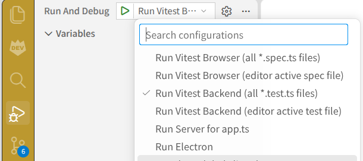

# Testing

Taon can run tests for both applications and libraries. Test files can live anywhere under `src/`. The file suffix determines which Taon command runs them, so you can keep tests next to the code they cover.

Run the commands from the root of the Taon project you want to test.

## Test types

| Test type | File suffix | Command | Use it for |
| --- | --- | --- | --- |
| Unit | `*.test.ts` | `taon test` | Backend logic and shared TypeScript code |
| Angular integration and component | `*.spec.ts` | `taon spec` | Angular components, services, and browser behavior |
| End-to-end (planned) | `*.e2e.ts` | `taon e2e` (planned) | Complete user workflows |

### Unit tests

Use `*.test.ts` files for Vite-based unit tests. They work well for backend logic and isomorphic code shared between the frontend and backend, such as validators, data transformations, and business rules.

```bash
taon test
```

For example, if your app shares a registration validator between an Angular form and a backend endpoint, use a unit test to cover which inputs the validator accepts or rejects.

### Angular integration and component tests

Use `*.spec.ts` files for Vite-based Angular integration and component tests. You can use Angular’s `TestBed` to configure the Angular dependencies your test needs and exercise components with their templates, forms, and services.

```bash
taon spec
```

For example, use a component test to check that the registration form displays the shared validator’s error message when a user enters an invalid value.

### End-to-end tests

> End-to-end testing is planned. The `taon e2e` command is currently unavailable.

End-to-end tests will use `*.e2e.ts` files to exercise complete workflows, such as submitting a registration form and signing in with the new account.

- **Local.** Taon will use WebSQL mode, where backend operations run inside the browser and SQL queries use `sql.js`. One Angular dev server will serve the app.
- **Taon Cloud.** When enabled, the app will send HTTP requests to a Node.js server during the test.

AI coding agents can verify changes with `taon test` and `taon spec`. End-to-end tests are optional for agent tasks.

## Run tests from VS Code

After you run `taon init`, the project’s generated VS Code launch configurations let you run tests from the **Run and Debug** view.

Open a `*.test.ts` or `*.spec.ts` file and select the configuration for the current file. To run the full unit or Angular test suite, select the corresponding configuration for all files.


